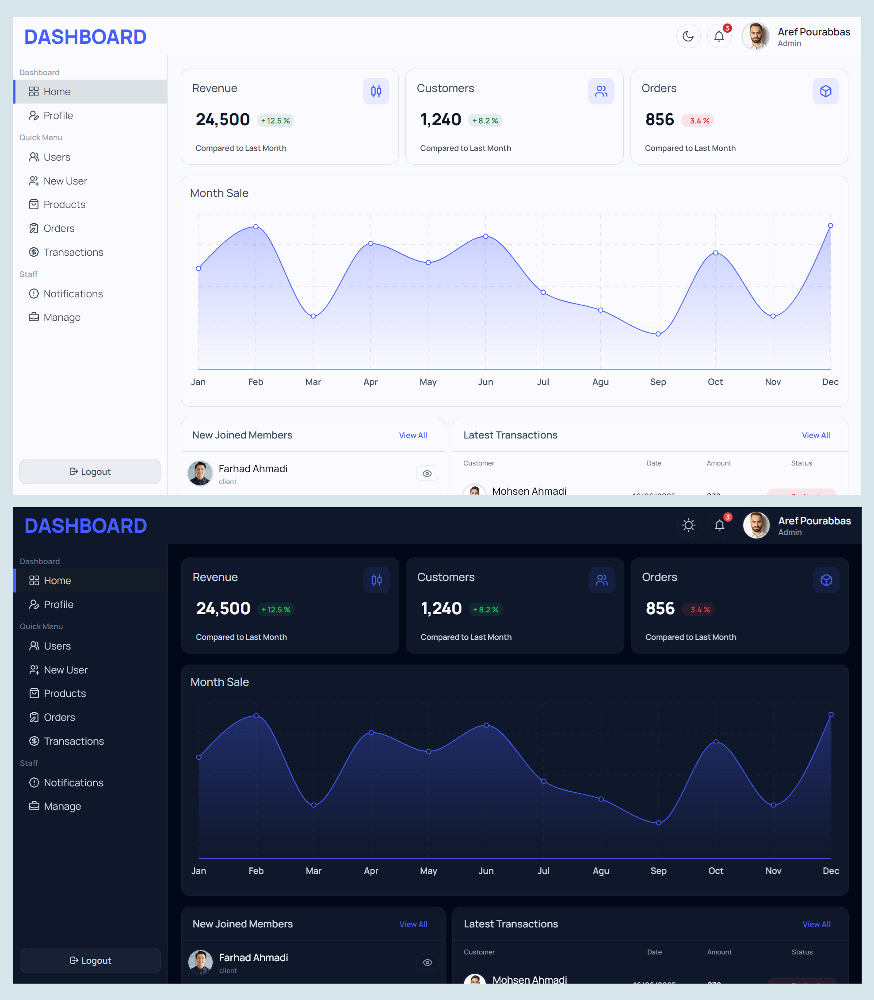
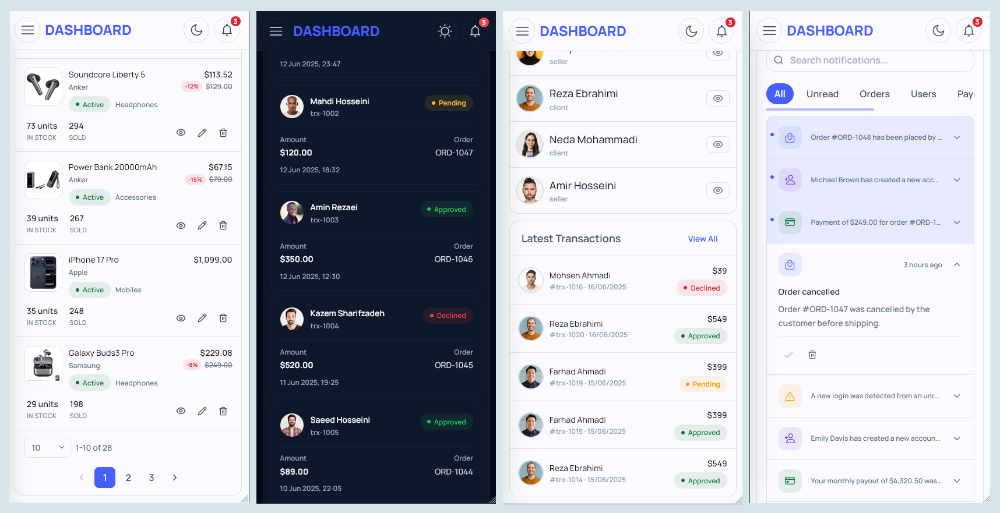
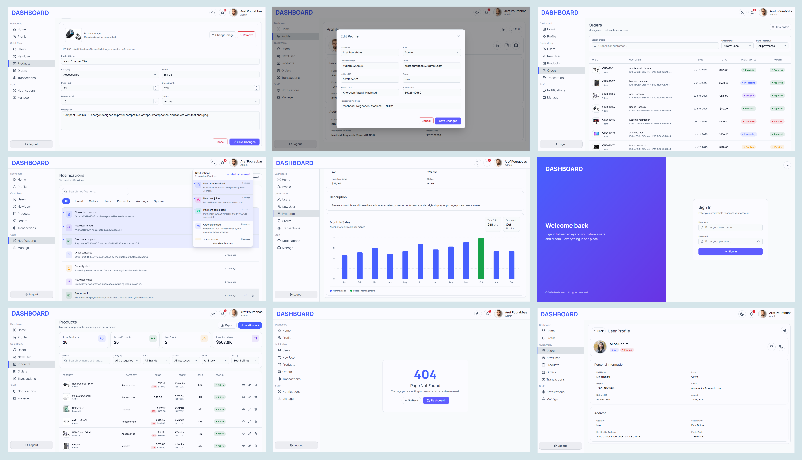

# Dashboard

A modern, responsive admin dashboard built with React 19, TypeScript, and Vite. It provides a centralized interface for managing users, products, orders, transactions, and notifications, with a mock REST API for local development.

## Screenshots





## Features

- **Authentication**
  - Login form with validation using React Hook Form and Zod.
  - Authentication state management with Zustand.
  - Protected dashboard routes.

- **Dashboard Home**
  - Revenue, customers, and orders summary cards.
  - Monthly sales chart.
  - Recently joined members.
  - Latest transactions.

- **User Management**
  - User listing with search and pagination.
  - Configurable page sizes.
  - Create and view user profiles.
  - Edit user information.
  - Avatar picker with image validation and resizing.

- **Product Management**
  - Product grid and list views.
  - Search and filtering.
  - Product status badges.
  - Product details and monthly sales chart.
  - Create and edit product forms.
  - Product image picker.
  - Stock, pricing, category, and brand information.

- **Order Management**
  - Orders table with status badges.
  - Order and payment status information.
  - Search and filtering.
  - Responsive mobile card layout.

- **Transaction Management**
  - Transaction listing with status badges.
  - Search, filters, and pagination.
  - Payment method and transaction details.

- **Notifications**
  - Notification feed with filtering options.
  - Read/unread states.
  - Skeleton loading states.

- **Theming**
  - Light and dark modes.
  - Persistent theme preference using Zustand.
  - CSS variable-based design tokens.

- **Responsive Design**
  - Layouts adapted for desktop, tablet, and mobile.
  - Responsive tables and mobile-friendly card layouts.
  - Reusable UI components.

## Tech Stack

| Category | Technology |
|---|---|
| Frontend | React 19, TypeScript |
| Build Tool | Vite 8 |
| Routing | React Router v7 |
| Client State | Zustand |
| Server State & Caching | TanStack React Query |
| HTTP Client | Axios |
| Forms | React Hook Form |
| Validation | Zod, `@hookform/resolvers` |
| Tables | TanStack Table |
| Charts | Recharts |
| Styling | Tailwind CSS v4 |
| UI Components | daisyUI |
| Icons | React Icons (`react-icons/lu`) |
| Mock API | json-server |
| Linting | ESLint 10, typescript-eslint |
| Fonts | Manrope, Vazirmatn |

## Technical Highlights

- **Feature-based organization:** Application code is organized by features, making the codebase easier to maintain and extend.
- **Separation of concerns:** Shared components, layouts, API logic, stores, and page-specific code are organized into separate areas.
- **Server-state management:** TanStack React Query handles API requests, caching, loading states, and query invalidation.
- **Client-state management:** Zustand manages application state such as authentication and theme preferences.
- **Form validation:** React Hook Form and Zod provide form handling and schema-based validation.
- **URL-synchronized state:** Search, filters, and pagination can be reflected in URL query parameters where implemented.
- **Lazy-loaded routes:** Route-level code splitting helps avoid loading every page upfront.
- **Reusable components:** Shared form fields, status badges, image pickers, and other UI components reduce duplication.
- **Responsive UI:** Tables and card layouts adapt to different screen sizes.
- **Mock REST API:** json-server provides local endpoints for developing and testing the application.
-  **Cross-tab authentication synchronization:** Uses the BroadcastChannel API to synchronize authentication-related state changes across multiple browser tabs.

## Project Structure

```text
src/
├── app/
│   ├── api/                 # Axios instance and API configuration
│   ├── router/              # Route definitions and lazy loading
│   └── store/               # Zustand stores
│       ├── auth/            # Authentication state
│       ├── sidebar/         # Sidebar state
│       └── theme/           # Theme preferences
│
├── layouts/
│   ├── auth/                # Authentication layout
│   └── dashboard/           # Dashboard shell, sidebar, and topbar
│
├── page/
│   ├── home/                # Dashboard overview and widgets
│   ├── login/               # Login page
│   ├── profile/             # User profile and editing
│   ├── users/               # User management
│   ├── products/            # Product management
│   ├── orders/              # Order management
│   ├── transactions/        # Transaction management
│   └── notifications/       # Notifications feed
│
├── shared/
│   ├── components/          # Reusable UI components
│   └── hooks/               # Shared custom hooks
│   
└── styles/                  # Global CSS, theme, colors, and fonts

index.html                   # HTML file

db.json                      # Mock API data
db.json.bak                  # Backup of mock API data
```

## Getting Started

### Prerequisites

- Node.js compatible with the installed Vite version.
- npm.

### 1. Clone the Repository

```bash
git clone <REPOSITORY_URL>
cd <PROJECT_DIRECTORY>
```

Replace the placeholders with your repository URL and project directory.

### 2. Install Dependencies

```bash
npm install
```

### 3. Start the Mock API

The application uses json-server to provide a local REST API based on `db.json`.

```bash
npm run mock-api
```

The API is expected to run at:

```text
http://localhost:4000/
```

Keep this terminal running while developing the application.

### 4. Start the Development Server

Open another terminal and run:

```bash
npm run dev
```

Open the local URL printed by Vite, typically:

```text
http://localhost:5173/
```

### 5. Build the Application

```bash
npm run build
```

### 6. Preview the Production Build Locally

```bash
npm run preview
```

### 7. Run ESLint

```bash
npm run lint
```

## Configuration

### API Configuration

The Axios instance is configured in:

```text
src/app/api/axios.ts
```

The API base URL can be changed there to match the backend configuration.

### Routing

Routes are defined in:

```text
src/app/router/router.tsx
```

Add or update route definitions when introducing new pages or features.

### Theme

Theme state and preferences are managed in:

```text
src/app/store/theme/theme.store.ts
```

Design tokens and global theme styles are defined in the project's CSS files under `src/styles/`.

### Mock API Data

The mock API uses:

```text
db.json
```

Update this file to modify the sample users, products, orders, transactions, notifications, and other available mock resources.

## Development Notes

- The mock API is intended for local development and testing.
- Data persistence and authentication behavior depend on the mock API implementation.
- The mock authentication flow should not be treated as production-grade security.
- The application uses local mock data rather than a production backend.
- Ensure the mock API is running before testing features that require server requests.
-  **Mock data backup:** `db.json.bak` contains a backup of the mock API data. If `db.json` is accidentally modified or corrupted, you can use the backup to restore the original data. Copy the contents of `db.json.bak` into `db.json` to restore it.

## Future Improvements

Potential improvements include:

- Integrating a production-ready backend.
- Adding automated unit and integration tests.
- Improving accessibility and keyboard navigation.
- Expanding dashboard analytics and reporting.
- Adding more advanced filtering and sorting options.
- Introducing role-based permissions where required.

## License

No license has been specified yet. All rights are reserved unless a license is added to this repository.

---

Built with React, TypeScript, and a focus on maintainable frontend architecture.